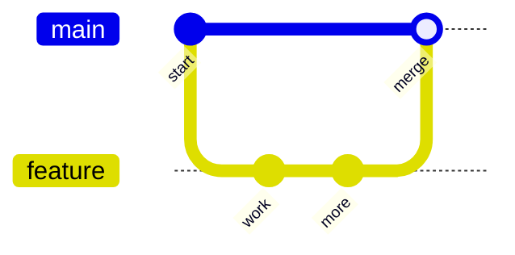

# Pictographic Git Cheat Sheet

Quick visual reference for everyday git. Copy-paste the commands as needed.

---

## 1. The three trees

```text
  [edit files] ──► (staging) ──► {commit} ──► remote
   working dir      index         repo         origin
```

| Symbol | Place | What it holds |
|--------|--------|----------------|
| `[ ]` | Working directory | Files you edit on disk |
| `( )` | Staging (index) | What will go into the next commit |
| `{ }` | Repository | Saved snapshots (commits) |
| `☁` | Remote (`origin`) | Shared copy on the server |

---

## 2. Daily loop

```text
  ?status  →  +add  →  ●commit  →  ↑push
                ↑
             ↓pull (get others' work first when needed)
```

| Pictograph | Command | Meaning |
|------------|---------|---------|
| `?` | `git status` | What changed? What's staged? |
| `+` | `git add <file>` | Stage a file |
| `++` | `git add .` | Stage everything in this folder |
| `●` | `git commit -m "message"` | Save a snapshot |
| `↑` | `git push` | Send commits to remote |
| `↓` | `git pull` | Fetch + merge remote into your branch |

Typical sequence:

```bash
git status
git add .
git commit -m "describe why you changed things"
git pull
git push
```

---

## 3. Branching

```text
  main  ●───●───●──────────●  (merge)
             \           /
  feature     ●───●───●
```



| Pictograph | Command | Meaning |
|------------|---------|---------|
| `⎇+` | `git branch <name>` | Create a branch |
| `⇄` | `git switch <name>` | Move to that branch |
| `⎇⇄` | `git switch -c <name>` | Create and switch |
| `⑂` | `git merge <name>` | Bring `<name>` into current branch |
| `⎇×` | `git branch -d <name>` | Delete a merged branch |

```bash
git switch -c feature/my-change
# ... edit, add, commit ...
git switch main
git merge feature/my-change
git branch -d feature/my-change
```

---

## 4. Undo safely

```text
  SAFE                          DANGEROUS
  ────                          ─────────
  unstage  ◌                    rewrite history ⚠
  discard unstaged  ✕           force-push ⚠⚠
  amend (local only) ✎          reset --hard ⚠
```

### Safe

| Pictograph | Command | Meaning |
|------------|---------|---------|
| `◌` | `git restore --staged <file>` | Unstage; keep file edits |
| `↩` | `git restore <file>` | Discard unstaged edits in that file |
| `✎` | `git commit --amend --no-edit` | Fold into last commit **only if not pushed** |

### Dangerous (ask first / avoid unless you know why)

| Pictograph | Command | Risk |
|------------|---------|------|
| `⚠` | `git reset --hard` | Throws away uncommitted work |
| `⚠⚠` | `git push --force` | Overwrites remote history |

Rule of thumb: if the commit is already on `origin`, do not amend or force-push.

---

## 5. Inspect

```text
  ●──●──●──●   log = walk the dots
       ↕         diff = compare two states
       ◎         show = one commit in detail
```

| Pictograph | Command | Meaning |
|------------|---------|---------|
| `●●●` | `git log --oneline -10` | Last 10 commits, short |
| `↕` | `git diff` | Unstaged changes |
| `↕(+)` | `git diff --staged` | Staged vs last commit |
| `◎` | `git show` | Latest commit (or `git show <hash>`) |

```bash
git log --oneline -10
git diff
git diff --staged
git show
```

---

## 6. Remote basics

```text
  your machine                         server
  ┌─────────────┐                      ┌─────────────┐
  │  local repo │  ←── ↓ fetch/pull ── │   origin    │
  │             │  ─── ↑ push ───────► │             │
  └─────────────┘                      └─────────────┘
```

| Pictograph | Command | Meaning |
|------------|---------|---------|
| `⬇☁` | `git clone <url>` | Copy a remote repo to your machine |
| `⟳` | `git fetch` | Download remote updates (no merge) |
| `↓` | `git pull` | Fetch + integrate into current branch |
| `↑` | `git push` | Upload your commits |
| `☁?` | `git remote -v` | Show remote URLs |
| `⎇☁` | `git branch -vv` | See which local branches track remotes |

```bash
git remote -v
git fetch
git pull
git push -u origin main   # first push / set tracking
git push                  # later pushes on a tracked branch
```

---

## Pocket card

```text
  ?  status     +  add       ●  commit
  ↓  pull       ↑  push      ⇄  switch
  ↕  diff       ●●● log      ◎  show
  ◌  unstage    ↩  restore   ✎  amend (unpushed only)
```
